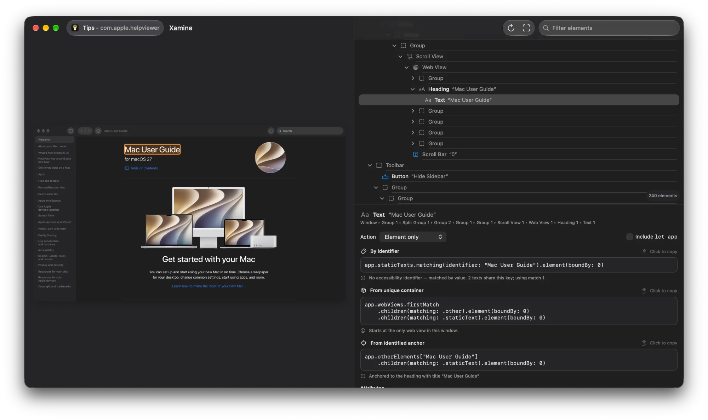

<p align="center">
  
</p>

<h1 align="center">Xamine</h1>

A menu-bar app for macOS that inspects any app's UI hierarchy and generates XCUITest queries for it.



- **⌘⇧X** (or *Inspect Application…* in the menu bar) starts a ⌘⇧5-style picker for app windows.
- **⌥⌘⇧X** inspects whatever is under the cursor without taking focus, for UI that closes when you click away: the menu bar and its menus, Spotlight, Control Center, the Dock, the desktop and Notification Center. *Inspect Under Cursor in 5 Seconds* does the same after a countdown.
- The inspector shows the window screenshot, the element hierarchy, and two queries for the selected element — by identifier/label and by hierarchy position. Click a query (or an element in the screenshot) to copy it.
- Picking the iOS Simulator window inspects the running iOS app.
- **Inspect iOS Device…** inspects apps on a wired iPhone (or a simulator) through a small XCUITest agent that Xamine builds and runs on the device.

## iOS devices

Xamine copies the agent project (`Agent/`) out of its bundle, builds it with `xcodebuild test` signed with your Apple Development team, and talks to it over HTTP: through the CoreDevice tunnel for a device, or localhost for a simulator. The agent serves `XCUIApplication(bundleIdentifier:).snapshot()` and screenshots, so element types and queries match XCUITest exactly.

The device needs, once:
- Developer Mode on (Settings ▸ Privacy & Security ▸ Developer Mode)
- UI Automation on (Settings ▸ Developer ▸ Enable UI Automation)
- Your Mac trusted, and Xcode signed in to the team you enter

Choose a specific app, or *App in the foreground* to follow whatever is open each time you re-scan (⌘R). The agent project is regenerated with `cd Agent && xcodegen generate`.

## Build

```sh
brew install xcodegen
xcodegen generate
open Xamine.xcodeproj
```

Xamine needs **Accessibility** and **Screen Recording** permission; it walks you through granting them on first launch. It can't be sandboxed, because the Accessibility API can't read other apps from inside the sandbox.

## Releases

*Check for Updates…* in the menu bar reads the latest release of `sjvandy/xamine` from GitHub. If it's newer, it offers to install it, replaces the app and relaunches. To ship an update:

1. Bump `MARKETING_VERSION` in `project.yml`.
2. Run `Packaging/make-dmg.sh`.
3. Publish a GitHub release tagged `v<version>` with `build/Xamine-<version>.dmg` attached.

The repository must be public for installed copies to see its releases.
