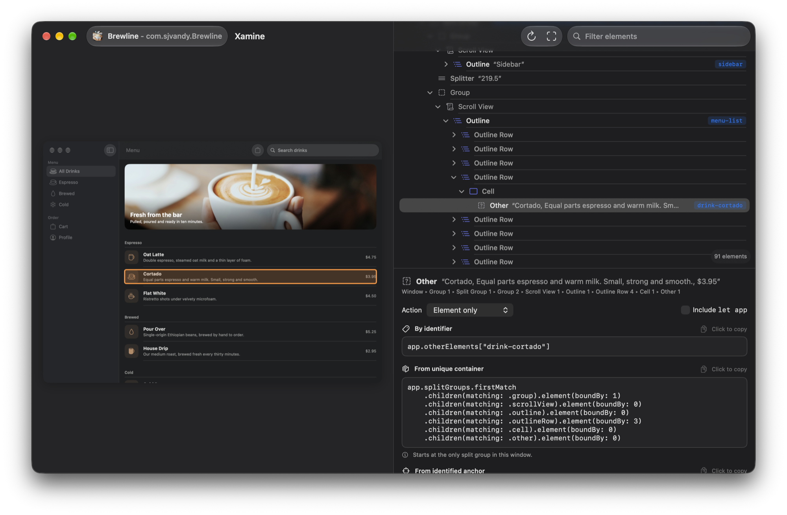

<p align="center">
  
</p>

<h1 align="center">Xamine</h1>

A menu-bar app for macOS that inspects any app's UI hierarchy and generates XCUITest queries for it.



- **⌘⇧X** (or *Inspect Application…* in the menu bar) starts a ⌘⇧5-style picker for app windows.
- **⌥⌘⇧X** inspects whatever is under the cursor without taking focus, for UI that closes when you click away: the menu bar and its menus, Spotlight, Control Center, the Dock, the desktop and Notification Center. *Inspect Under Cursor in 5 Seconds* does the same after a countdown.
- The inspector shows the window screenshot, the element hierarchy, and two queries for the selected element — by identifier/label and by hierarchy position. Click a query (or an element in the screenshot) to copy it.
- Picking the iOS Simulator window inspects the running iOS app.
- **Inspect iOS Device…** inspects apps on a wired iPhone (or a simulator) through a small XCUITest agent that Xamine builds and runs on the device.
- **AI agents** such as Claude Code can drive Mac apps through Xamine to write new XCUITests or find out why one fails. *Set Up AI Agents…* connects them in one click.

## AI agents

Xamine serves an automation API that lets an agent work with any Mac app without you touching it: launch the app, read its hierarchy, click and type, and turn what it did into an XCUITest. When a UI test breaks, the agent can ask Xamine why its query no longer matches the live UI.

### Setup

Choose **Set Up AI Agents…** in the menu bar (or Settings › AI Agents). For Claude Code, and for Claude in Xcode if you use it, Xamine:

- registers its MCP server with `claude mcp add --scope user`, and
- installs an `xamine` skill that tells the agent when to use Xamine and how to create or repair a UI test with it.

Start a new conversation afterwards. To set it up by hand, or for another MCP client:

```sh
claude mcp add --scope user xamine -- /Applications/Xamine.app/Contents/Helpers/xamine mcp
```

The same helper is a command-line tool, for scripts and agents without MCP:

```sh
xamine launch-app com.apple.tips
xamine find-elements --text "User Guide"
xamine click e42
xamine resolve-query 'app.windows["Shopping Cart"]'
xamine help
```

### Tools

| Tool | What it does |
|---|---|
| `status`, `list_apps` | Permissions, frontmost app, running apps and their windows |
| `launch_app` | Launches or activates an app by bundle ID, name or path; with several builds installed, opens the newest |
| `snapshot`, `find_elements` | The window's hierarchy with refs (`e12`), or a search with the best query for each match |
| `screenshot`, `get_queries` | A PNG of the window or an element; every query Xamine can generate for an element |
| `click`, `type_text`, `press_key`, `scroll` | Act on an element by ref or XCUITest query; each returns the equivalent XCUITest line |
| `wait_for` | Waits for a query or text to appear or disappear, and records an assertion |
| `recording_start`, `recording_stop` | Turns the actions in between into a complete `XCTestCase` file |
| `resolve_query` | Evaluates a query against the live UI step by step: where it stops matching, what's there instead, and a text-free alternative |

### Examples

> Create a UI test that opens Brewline's Cold category, orders a large Cold Brew with an extra shot and checks the cart.

The agent explores with `snapshot`, records the flow and saves the generated test, which passes as recorded:

```swift
let drinkColdBrewButton = app.buttons["drink-cold-brew"]
XCTAssertTrue(drinkColdBrewButton.waitForExistence(timeout: 5))
drinkColdBrewButton.click()
```

> CartTitleTests is failing. Find out why and fix it.

The agent replays the test's steps and asks `resolve_query`:

```
1. .windows           → 1 element
2. ["Shopping Cart"]  → 0 elements   ← stops matching here
Step 2 had 1 element to choose from:
  e0 Window title="Cart"
    query: app.windows["Cart"]
```

### Notes

- Agents can drive **macOS apps** for now. iPhone and iPad apps are inspect-only.
- Xamine moves the real mouse and types on the real keyboard while an agent drives, so leave them alone until it's done.
- The API listens on a socket in `~/Library/Application Support/Xamine` that only your user account can open, whenever Xamine is running.
- Running UI tests on a Mac needs Automation Mode once. If `xcodebuild test` times out enabling it, run `sudo automationmodetool enable-automationmode-without-authentication`, or run the tests once from Xcode and approve the prompt.

## iOS devices

Xamine copies the agent project (`Agent/`) out of its bundle, builds it with `xcodebuild test` signed with your Apple Development team, and talks to it over HTTP: through the CoreDevice tunnel for a device, or localhost for a simulator. The agent serves `XCUIApplication(bundleIdentifier:).snapshot()` and screenshots, so element types and queries match XCUITest exactly.

The device needs, once:
- Developer Mode on (Settings ▸ Privacy & Security ▸ Developer Mode)
- UI Automation on (Settings ▸ Developer ▸ Enable UI Automation)
- Your Mac trusted, and Xcode signed in to the team you enter

Choose a specific app, or *App in the foreground* to follow whatever is open each time you re-scan (⌘R). The agent project is regenerated with `cd Agent && xcodegen generate`.

## Build

```sh
brew install xcodegen
xcodegen generate
open Xamine.xcodeproj
```

Xamine needs **Accessibility** and **Screen Recording** permission; it walks you through granting them on first launch. It can't be sandboxed, because the Accessibility API can't read other apps from inside the sandbox.

## Releases

*Check for Updates…* in the menu bar reads the latest release of `sjvandy/xamine` from GitHub. If it's newer, it offers to install it, replaces the app and relaunches. To ship an update:

1. Bump `MARKETING_VERSION` in `project.yml`.
2. Run `Packaging/make-dmg.sh`. It checks that the app and its bundled `xamine` helper are signed with Developer ID.
3. Publish a GitHub release tagged `v<version>` with `build/Xamine-<version>.dmg` attached.

The repository must be public for installed copies to see its releases.
